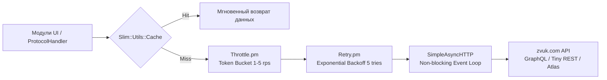

# Руководство Senior Perl разработчика и Архитектурный план модернизации плагина LMS Zvuk

**Проект:** `lms-zvuk` (плагин сервиса «Звук» для Lyrion Music Server / Logitech Media Server)  
**Репозиторий:** `/home/chernysh/Projects/lms-zvuk`  
**Исследованные материалы:** 
* `zvuk-api-docs-v2/` (Android APK 4.116.0rs, 196 GraphQL-операций, Retrofit-сервисы, интерцепторы);
* `zvuk-api-docs/` (Web-клиент, живые дампы 34 фикстур);
* `atlas-research/` (исследование сервиса `atlas.zvuk.com`, захваты сессий, дампы графа);
* `zvuk_apk_atlas_research/` (декомпиляция APK 4.117.0rs, WAF Servicepipe `clv.java`);
* `docs/ROADMAP_2026-10.md` (внутренний аудит кодовой базы и сопоставительный анализ).  
**Целевая аудитория:** Senior Perl Developer / LMS Plugin Architect  
**Статус:** Согласованный мастер-план и техническое руководство (без изменения рабочего кода на данном этапе)

---

## 1. Архитектурный контекст и состояние кодовой базы

Плагин `lms-zvuk` разработан для работы внутри сервера Lyrion Music Server (LMS 8.0+) и опирается на однопоточную асинхронную событийную модель (`Slim::Networking::SimpleAsyncHTTP`, `Slim::Utils::Timers`, `EV/AnyEvent`).

### 1.1. Действующий конвейер сетевых запросов


### 1.2. Фундаментальные архитектурные правила LMS
1. **Zero-blocking:** Категорически запрещены любые блокирующие системные вызовы (`sleep`, синхронный `LWP::UserAgent`, тяжелые синхронные вычисления). Любая сетевая задержка в главном потоке LMS приводит к опустошению аудиобуфера и заиканию звука на плеерах Squeezebox.
2. **Мультирум и Per-Client State:** Никогда не хранить активного пользователя, сессию или токен в статических переменных модулей (`our`, `state`). Плееры в доме могут быть привязаны к разным аккаунтам. Всегда резолвить клиента:
   ```perl
   my $userId = $prefs->client($client)->get('userId') || $prefs->get('defaultUserId');
   my $api    = Plugins::Zvuk::Plugin::_get_api_client($userId);
   ```
3. **Многоповерхностность UI (`_uiKind`):**
   * `weblink_capable` (Material Skin, Desktop Web) → современные web-страницы, ссылки `weblink`, Canvas-виджеты.
   * `squeezeplay` (Squeezebox Touch, Radio, Controller) → нативные многоуровневые XMLBrowser меню с обложками.
   * `player_buttons` (Squeezebox Classic SB3, Boom, Transporter) → одно-двухстрочные VFD экраны, физический ИК-пульт/энкодер, строгий учет стека режимов (`Slim::Buttons::Common::popMode`).

---

## 2. Фаза 0: Стабилизация ядра, устранение техдолга и авторизация

Перед масштабированием плагина необходимо устранить выявленные скрытые дефекты кодовой базы.

### 2.1. Обязательные багфиксы в коде

| # | Проблема | Файл и строки | Категория сложности | Решение |
|---|---|---|---|---|
| 1 | **Критический обрыв кэширования:** `return $cached` внутри блока `map`. В Perl `return` внутри `map` выходит из всей внешней функции. При первом же попадании в кэш обработка батча прекращается, и остальные треки не кэшируются. | `API.pm:128-131` | **Мелкий / Быстрый** | Переписать на `for my $track (@$tracks)` без досрочного `return`. |
| 2 | **Сбой веб-интерфейса:** Perl-вызов `require('Plugins::Zvuk::API::Async')` в клиентском JS ломает кнопку гостевого входа `ReferenceError`. | `basic.html:350` | **Мелкий / Быстрый** | Удалить строку; использовать зарегистрированный URL `/plugins/zvuk/getAnonymousToken`. |
| 3 | **Сломанная обратная связь Волны:** `zvuk_wave_last_track` опрашивается, но нигде не сохраняется. `contentInput` всегда пустой. | `ProtocolHandler.pm:329-348` | **Сложный** *(отдельный коммит)* | Сохранять `{id, started, duration}` в `getNextTrack` при игре треков волны; сбрасывать по событию `stop`. |
| 4 | **Фейковый `userId` OAuth:** при входе через веб-окно сохраняется временный `userId = substr(token, 0, 16)` навсегда. | `WebHandlers.pm:283-294` | **Сложный** *(отдельный коммит)* | После получения токена асинхронно запросить профиль `/api/v2/tiny/profile` и пересохранить с реальным ID. |
| 5 | **GigaMix autoplay no-op:** настройка «GigaMix autoplay» сохраняется в преференсы, но нигде не читается. | `Settings.pm:26`, `Plugin.pm:48` | **Мелкий / Быстрый** | Учесть настройку в блоке автопродления `ProtocolHandler.pm:79-90` (подгружать ли следующую страницу по курсору). |
| 6 | **REST-вызовы мимо троттлера:** метод `_http_get` (`getProfile`, подборки, анонимный токен) ходит в сеть напрямую в обход очереди. | `API/Async.pm:316-361` | **Сложный** *(отдельный коммит)* | Пропустить `_http_get` через общий конвейер `Throttle.pm` и `Retry.pm`. |
| 7 | **Циклическая утечка памяти в ретраях:** лексическая переменная `$run_operation` замкнута сама на себя без сброса. | `Retry.pm:72-108` | **Мелкий / Быстрый** | Добавить `undef $run_operation;` перед вызовом успешного/ошибочного завершения. |
| 8 | **Засорение логов в проде:** отладочные сообщения пишутся через `$log->warn` вместо `$log->debug`. | `WaveUI.pm:286-294`, `API/Async.pm:146-148` | **Мелкий / Быстрый** | Перевести на `$log->debug`. |
| 9 | **Мёртвый код:** неиспользуемые модули и заглушки. | разные | **Мелкий / Быстрый** | Удалить `WaveWizardUI.pm` (343 строки); почистить `_render*Item` в `Plugin.pm:813-838`; зарегистрировать забытый роут `handleGetWaveSettingsWeb` (`WebHandlers.pm:207-238`). |
| 10| **Гигиена секретов:** рабочий токен захардкожен в скриптах тестирования. | `test/test_editorial_real.*`, `test/token.txt` | **Мелкий / Быстрый** | Вынести токен в переменную окружения `$ENV{ZVUK_TOKEN}`. |

> [!NOTE]
> Мелкие багфиксы (пп. 1, 2, 5, 7, 8, 9, 10) разрешено объединить в **один общий коммит**. Сложные пункты (пп. 3, 4, 6) выделяются в отдельные атомарные коммиты с индивидуальной верификацией.

---

### 2.2. Полноценная авторизация: SMS OTP и автоматический Refresh токена

#### А. Автоматический Refresh токена при HTTP 401 *(Сложная задача, отдельный коммит)*
Токен доступа (`x-auth-token`) живёт **7 дней** и ротируется при любом повторном входе в браузере. Вызов продления сессии подтвержден в APK (сервис `gdy`):
```http
POST https://zvuk.com/api/tiny/refresh
X-Auth-Token: <current_expired_token>
X-C-P: Q
Content-Type: application/json
```
> [!WARNING]
> **Опасная ловушка:** Эндпоинт `id.zvuk.com/api/v2/token/refresh` из веб-бандла без браузерных cookies создает **анонимную** сессию (ломая подписку). Использовать строго `https://zvuk.com/api/tiny/refresh`.

**Паттерн интерцептора в `API/Async.pm`:**
1. При получении HTTP 401 в `_graphql` или `_http_get` проверяется флаг `{refreshed}`.
2. Выполняется ровно один запрос `POST /api/tiny/refresh`.
3. Новый токен сохраняется в преференсы LMS (`accounts->{$userId}->{token}`).
4. Выполняется **один** повторный вызов исходного запроса с новым токеном.
5. При повторном 401 — аккаунт помечается флагом `stale`, а в UI выводится локализованное сообщение «Требуется повторный вход».

#### Б. Нативный вход по номеру телефона (SMS OTP) *(Сложная задача, отдельный коммит)*
Интегрируется в веб-интерфейс настроек плагина (`basic.html`) и поддерживается обработчиками в `WebHandlers.pm`:
1. `GET https://zvuk.com/api/tiny/route-authorization-type?phone_number=+7...` (с `X-C-P: Q`).
2. `POST https://zvuk.com/api/tiny/get-mcode?phone_number=+7...&type=sms&length=4` (с `X-C-P: Q`).
3. `POST https://zvuk.com/api/tiny/login/otp` (body: `phone_number`, `code`, заголовок `X-C-P: Q`).
4. Токен и числовой `id` пользователя сохраняются в преференсы.
5. Ручной ввод токена сохраняется в интерфейсе как надёжный fallback.

---

## 3. Фаза 1: Контекстное радио, тексты Musixmatch, DSTM и эфирные радиостанции

### 3.1. Бесконечное радио по сущности (`recommenderRadio`)
* **GraphQL Запрос:**
  ```graphql
  query recommenderRadio($id: ID!, $type: RecommenderRadioEntityType!, $limit: NonNegativeInt! = 25, $cursor: NonNegativeInt = 0) {
    recommenderRadio(onEntity: { id: $id, type: $type }, first: $limit, cursor: $cursor) {
      cursor
      tracks {
        id
        title
        duration
        explicit
        hasFlac
        artists { id title }
        release { id title image { src } }
        streamV2 { preview }
      }
    }
  }
  ```
* **Поведение очереди:** Согласно принятому решению — **всегда очищать текущую очередь и немедленно начинать воспроизведение** (сценарий потоковой радиостанции).
* **Схема URI:** `zvuk://radio:track:<id>`, `zvuk://radio:artist:<id>`, `zvuk://radio:release:<id>`.
* **Автоподгрузка:** При остатке $\le 2$ треков в очереди `ProtocolHandler` выполняет следующий запрос с сохраненным `cursor` и бесшовно дописывает пачку треков в конец плейлиста.
* **Контекстные меню:** Регистрация в `Browse/InfoMenu.pm` пунктов «Включить радио по треку» и «Радио артиста».

---

### 3.2. Интеграция с плагином LMS «Don't Stop The Music» (DSTM)
* Популярнейший плагин LMS DSTM подмешивает похожую музыку, когда текущий плейлист подошел к концу.
* **Интеграция:** Регистрация Zvuk как DSTM-провайдера.
* **Запрос похожих треков:**
  ```graphql
  query getTrackRelatedTracks($trackId: ID!, $limit: Int! = 10) {
    track(id: $trackId) {
      relatedTracks(limit: $limit) {
        id
        title
        duration
        artists { id title }
        release { id title image { src } }
      }
    }
  }
  ```
  При завершении очереди DSTM берет ID последнего сыгранного трека и бесшовно подмешивает 10 похожих треков из каталога Звука.

---

### 3.3. Синхронизированные тексты песен (Musixmatch)
* **Эндпоинт:** `GET https://zvuk.com/api/tiny/musixmatch/lyrics?track_id={id}&translation=false`.
* **Интеграция:** Регистрация провайдера в `Browse/InfoMenu.pm`:
  `Slim::Menu::TrackInfo->registerInfoProvider(zvuk_lyrics => ...)`.
* Структурированные субтитры форматируются и выводятся в стандартные экраны Lyrics плееров LMS и Material Skin.

---

### 3.4. Эфирные радиостанции (Digital Radio)
* **GraphQL операции:** `getRadioStations(broadcastType, first, skip, randomOrder)` и `getRadioMetaData`/`getRadioStreamMetaData` (метаданные текущего трека в эфире).
* Позволяет вывести в главное меню каталог эфирных станций (DFM, Русское Радио, Хит FM и др.) с живым отображением трека, играющего в эфире.

---

## 4. Фаза 2: Полноценная интеграция «Атласа вкуса» (`atlas.zvuk.com`)

### 4.1. Спецификация API «Атласа»
* Базовый URL: `https://atlas.zvuk.com/api/v1/*`
* **Авторизация (Критично):** Эндпоинты отвергают заголовок `X-Auth-Token`. Плагин обязан передавать:
  ```http
  Cookie: auth=<token>; in_webkit=true
  ```
* **Эндпоинты:**
  * `GET /api/v1/map` — 79 островов вкуса на плоскости Valence [-1..1] × Energy [-1..1]. Кэш в LMS на 1 час (3600 с).
  * `GET /api/v1/map/islands/{id}` — первые 50 треков острова.
  * `PUT /api/v1/map/islands/{id}/wave` — регистрация старта потока.
  * `GET /api/v1/map/islands/{id}/wave?limit=20[&cursor=...]` — получение очереди волны острова с полем `next_cursor`.

### 4.2. Стриминг треков острова
* **Схема URI:** `zvuk://atlas:<island_id>`.
* Треки острова играются **штатным механизмом** `zvuk://<track_id>` через существующий GraphQL-метод `mediaContents` (`getStream`), обеспечивая воспроизведение в оригинальном **FLAC Lossless** с битрейтом до 24-bit. Специфичный эндпоинт стрима Атласа (`/api/v1/track/{id}/stream`) игнорируется, так как он отдает аудио со стандартным сжатием.
* При остатке $\le 2$ треков очередь пополняется через `GET /wave?cursor=<next_cursor>`.

### 4.3. Архитектура меню в LMS (`AtlasUI.pm`)

Согласно утвержденной концепции формируется гибридное меню:

```
[Главное меню Zvuk]
  └── 🗺️ Атлас вашего вкуса
        ├── 🌟 Все острова (Топ вашего вкуса)    [79 островов по убыванию доли share]
        ├── 📁 По семействам жанров               [53 папки: Рок, Джаз, Электроника...]
        │     └── 📁 Рок (5 островов · 451 тр.)
        │           ├── ▶ Холодный рок (66 тр.)
        │           ├── ▶ Буйный рок (112 тр.)
        │           └── ...
        ├── 🎭 По настроениям                     [36 папок: Меланхолия, Драйв, Покой...]
        │     └── 📁 Меланхолия (3 острова)
        │           ├── ▶ Одинокая классика
        │           └── ...
        ├── 🎲 Случайный остров (Мне повезёт)    [Мгновенный запуск рандомного острова]
        └── 🌐 Открыть карту вкуса (Web)         [weblink на atlasStandalone.html]
```

#### Интерактивный 2D-виджет (`HTML/EN/plugins/zvuk/atlasStandalone.html`)
* Для браузера и Material Skin создается отдельная HTML5-страница.
* На `<canvas>` отображается 2D-плоскость с координатными осями Valence / Energy, облаками и интерактивными островами.
* Размер круга острова зависит от `track_count`, цвет берется из квадранта настроения.
* Клик по острову на Canvas отправляет JSON-RPC команду в LMS:
  `['playlist', 'play', 'zvuk://atlas:' + islandId]`.

---

## 5. Фаза 3: Разговорный контент и История прослушиваний

В соответствии с инструкцией пользователя разговорный контент объединен в общий раздел, а История вынесена на верхний уровень меню.

```
[Главное меню Zvuk]
  ├── 🔍 Поиск
  ├── 🌊 Моя волна
  ├── 🗺️ Атлас вкуса
  ├── 🕒 История прослушиваний   <-- [Верхний уровень]
  ├── 🎙️ Подкасты и аудиокниги   <-- [Объединенный раздел]
  │     ├── 📚 Аудиокниги
  │     │     ├── Топ книг
  │     │     ├── Жанры (BISAC)
  │     │     └── Авторы
  │     └── 🎙️ Подкасты
  │           ├── Популярные шоу
  │           └── Категории
  ├── 🎼 Моя музыка (Коллекция)
  └── ⚙️ Настройки
```

### 5.1. «История прослушиваний» (Recent History)
* **GraphQL Запрос:** `listeningRecentV1(itemType: [RecentItemType!], limit: Int!, offset: Int!)`.
* **Полиморфный диспетчер рендера:** Модуль `Browse/RecentUI.pm` инспектирует `__typename` каждого элемента (`TrackHistoryItem`, `EpisodeHistoryItem`, `ChapterHistoryItem`) и отображает соответствующую иконку, заголовок и URI воспроизведения.

### 5.2. «Подкасты и аудиокниги» (Audiobooks & Podcasts)
* **Аудиокниги:**
  * Запросы `getBooks(ids: [...])`, `getChapters(ids: [...])`.
  * Иерархия навигации: `Книга` ➔ `Список глав` (`Chapter`).
  * Воспроизведение главы: `zvuk://chapter:<chapter_id>`.
  * Резолвинг потока в `ProtocolHandler`: вызов GraphQL `mediaContents` с фрагментом `... on Chapter { stream { high mid } }`.
  * Интеграция с подсистемой LMS Track Position / Bookmarking (`Slim::Player::Source::trackPosition`) для сохранения прогресса прослушивания главы.
* **Подкасты:**
  * Каталог и выпуски через пакетный эндпоинт `/sapi/meta?non_music_lists=...`.
  * Воспроизведение эпизодов через `zvuk://episode:<episode_id>`.

---

## 6. Защита от WAF и эксплуатационная надежность

1. **HTTP 418 (Штрафной режим анти-бота):**
   * При интенсивных запросах (>40-50 вызовов за 30 мин) сервер блокирует IP кодом 418.
   * `Retry.pm` должен перехватывать 418 и переводить `Throttle.pm` в штрафной режим (1 запрос в 5-10 секунд на 15 минут) с понятным уведомлением в UI вместо падения плагина.
2. **Консервативный дефолт троттлинга:**
   * Сделать лимит запросов в `Throttle.pm` настраиваемым через Prefs: по умолчанию выставить консервативные **2 rps** (или 1 запрос в секунду), а текущие 5 rps оставить как опцию для производительных сетей.
3. **Безопасная загрузка витрин и новинок:**
   * Запрос `dynamicBlockV2` с IP серверных датацентров часто возвращает HTTP 400.
   * Для витрин и подборок использовать стабильный REST Grid API: `GET /api/tiny/grid/content?name=editorial_playlist` и `GET /api/tiny/grid?name=main&market=`.

---

## 7. Стандарты разработки и Гайдлайн для Senior Perl Developer

### 7.1. Стандарты Modern Perl в среде Lyrion Music Server
1. **Прагмы и кодировки:**
   Каждый `.pm` файл обязан начинаться с:
   ```perl
   package Plugins::Zvuk::Submodule;
   
   use strict;
   use warnings;
   use utf8;
   ```
2. **Безопасные идиомы:**
   * Допустим оператор `//` (defined-or, Perl 5.10+).
   * Использовать `Scalar::Util qw(blessed looks_like_number)` вместо ненадежных строковых регулярок для проверки типов.
   * **Запрещены:** экспериментальные фичи старших версий Perl (`signatures`, `postfix dereference`, `try/catch` из 5.34+), так как LMS часто эксплуатируется на устаревших NAS с Perl 5.14–5.24.

### 7.2. Идиомы асинхронности и таймеров LMS
* **Таймеры — только абсолютное время epoch:**
  В LMS метод `Slim::Utils::Timers::setTimer($obj, $epoch_time, $coderef)` принимает **абсолютное время** (`Time::HiRes::time() + $delta`). Передача относительного смещения `$delta` приводит к зависанию или немедленному холостому срабатыванию.
* **Passthrough в OPML:**
  При построении цепочек меню передавать уже полученные данные через `passthrough => [{ key => $val }]`, исключая дублирующие сетевые запросы при возврате по кнопке `BACK`.
* **Безопасная обработка VFD экранов (`player_buttons`):**
  На кнопочных плеерах (Squeezebox Boom/Classic) нажатие `RIGHT` или `PLAY` в режиме `xmlbrowser` перед сменой экрана требует вызова `Slim::Buttons::Common::popMode($client)` для предотвращения опустошения стека и моргания дисплея.

---

## 8. Регламент разработки, Git-политика и интерактивная верификация

> [!IMPORTANT]
> **ОБЯЗАТЕЛЬНЫЙ РЕГЛАМЕНТ РАБОТЫ (MANDATORY WORKFLOW):**
> Данный регламент является строгим протоколом взаимодействия разработчика/агента с пользователем при реализации дорожной карты.

### 8.1. Политика коммитов и группировка задач

1. **Пакетный коммит для мелких багфиксов (Раздел 2.1):**
   Очевидные и мелкие правки кода из таблицы 2.1 (исправление уровней логов WARN->DEBUG, чистка мёртвого кода `WaveWizardUI.pm`, устранение циклической утечки замыкания в `Retry.pm`, удаление ошибочного `require` в `basic.html`, исправление `return` в `map` в `API.pm`, фикс секрета в тестах и преф GigaMix) **разрешено сразу закоммитить одним общим коммитом**:
   * `fix(core): apply minor bugfixes, memory leak fix and dead code cleanups (Phase 0.1)`
   Для этого общего пакета формируется **один сводный запрос на ручную проверку**.

2. **Строго отдельные коммиты для сложных задач:**
   Любые задачи, требующие сложного кодирования, сетевой маршрутизации или нетривиальной ручной проверки (например:
   * пропуск `_http_get` через конвейер `Throttle.pm`/`Retry.pm` (п. 2.1.6);
   * сохранение обратной связи Волны в `ProtocolHandler.pm` (п. 2.1.3);
   * асинхронный резолвинг `userId` в `WebHandlers.pm` (п. 2.1.4);
   * авторефреш сессии при HTTP 401;
   * SMS OTP авторизация;
   * потоковое радио `recommenderRadio`;
   * модуль «Атласа вкуса» `API/Atlas.pm` и меню `AtlasUI.pm`;
   * аудиокниги и история),
   **оформляются строго отдельными атомарными коммитами** с персональным интерактивным шлюзом верификации.

---

### 8.2. Интерактивный шлюз ручной верификации (Interactive Verification Gate)
Сразу после выполнения изменений и фиксации коммита разработчик/агент **ОБЯЗАН остановить дальнейшую работу** и предоставить пользователю подробный структурированный чек-лист с рекомендациями по ручному тестированию.

#### Обязательный структурированный шаблон запроса:
При каждом обращении к пользователю разработчик/агент выводит сообщение в строгом формате:

```markdown
### 🚀 Подпункт [Номер и Название] реализован в коммите [hash]

#### 1. ➕ Что должно добавиться:
* [Перечень новых пунктов меню, кнопок, параметров в настройках, виджетов или файлов]

#### 2. 🔄 Что должно измениться:
* [Изменения в поведении плеера, новый порядок очереди, формат метаданных, заголовки сети]

#### 3. 🛠️ Что исправлено:
* [Какая ошибка, баг или некорректное поведение устранены; что больше не должно падать]

#### 4. 🔍 Инструкция: Как именно проверять (шаги и фокус внимания):
* **Шаг 1:** [Куда зайти в веб-интерфейсе / Material Skin / пульте плеера]
* **Шаг 2:** [Что именно нажать или какое действие запустить]
* **Шаг 3:** [На что обратить внимание: статус плеера, таймер, задержка старта, логика переходов]
* **Проверка логов:** [Какую строку проверить в файле server.log: `grep -i zvuk server.log`]

---
❓ **Будете ли вы проводить дополнительную ручную проверку на сервере LMS / плеере?**
```

#### Протокол обработки ответа пользователя:
* **Если пользователь отвечает «Нет»** (или выбирает пропуск ручной проверки):
  ➔ Разработчик/агент фиксирует успешный статус подпункта и **немедленно приступает к реализации следующего подпункта**.
* **Если пользователь отвечает «Да»** (или начинает ручное тестирование):
  ➔ Разработчик/агент **полностью останавливает работу** и ожидает результатов ручной проверки.
  ➔ Переход к следующему подпункту разрешен **только после явного подтверждения** от пользователя (*«Проверил, всё работает, продолжаем»*). В случае обнаружения дефектов — разработчик сначала устраняет замечания в рамках текущего шага.

---

## 9. Чек-лист проверки и план валидации (Verification Plan)

| Компонент / Фича | Метод проверки и тестовые фикстуры | Ожидаемый результат |
|---|---|---|
| **API.pm (Кэширование)** | Модульный тест `t/test_cache_batch.t` | Массив из 50 треков полностью оседает в кэше без досрочного выхода на 1-м элементе. |
| **Retry.pm (Память)** | Тест `t/test_retry_leak.t` | Отсутствие циклических ссылок после успешного или неудавшегося ретрая. |
| **Refresh 401** | Интеграционный тест со стабом HTTP 401 на `_graphql` | Перехват 401, вызов `POST /api/tiny/refresh`, автоповтор исходного запроса с новым токеном. |
| **recommenderRadio** | Live-тест `test/test_radio.pl` + LMS меню | Очередь очищается, начинается воспроизведение, при остатке <=2 треков список автоматически пополняется. |
| **DSTM интеграция** | Завершение плейлиста в LMS с активным DSTM | LMS автоматически запрашивает 10 похожих треков через `getTrackRelatedTracks` и продолжает играть. |
| **Атлас (Парсер графа)** | Тест на фикстуре `atlas-research/capture/api_v1_map_full.json` (137 КБ) | Все 79 островов корректно парсятся, группируются по 53 жанрам и 36 настроениям. |
| **Атлас (Cookie Auth)** | Модульный тест `t/test_atlas_auth.t` | Запрос к `atlas.zvuk.com` содержит заголовок `Cookie: auth=<token>; in_webkit=true`. |
| **Атлас (Воспроизведение)** | Выбор острова на Squeezebox Classic / Material Skin | Запускается бесконечный FLAC-стрим `zvuk://atlas:<id>`. |
| **Подкасты и Книги** | Проверка навигации меню | Объединенный корневой раздел корректно раскрывается в подкасты и аудиокниги. |
| **История прослушиваний**| Тест полиморфного рендера `listeningRecentV1` | Корректный рендеринг треков, эпизодов подкастов и глав книг в верхнем уровне меню. |
| **Smoke-пробы API** | Набор тестов на фикстурах `zvuk-api-docs/evidence/json/` | Валидация совместимости парсеров перед каждым релизом. |

---

## Заключение

План модернизации плагина `lms-zvuk` объединяет все подтвержденные находки реверс-инжиниринга: самовосстанавливающуюся сессию, бесконечное радио `recommenderRadio`, глубокую интеграцию карты «Атлас вкуса», поддержку «Don't Stop The Music», тексты песен, разговорный контент и строгую защиту от WAF-блокировок.

Сбалансированная политика коммитов (пакетный коммит для простых багфиксов + строго раздельные коммиты для сложных задач со шлюзом проверки) обеспечивает оптимальную скорость разработки при 100% контроле качества со стороны пользователя.
